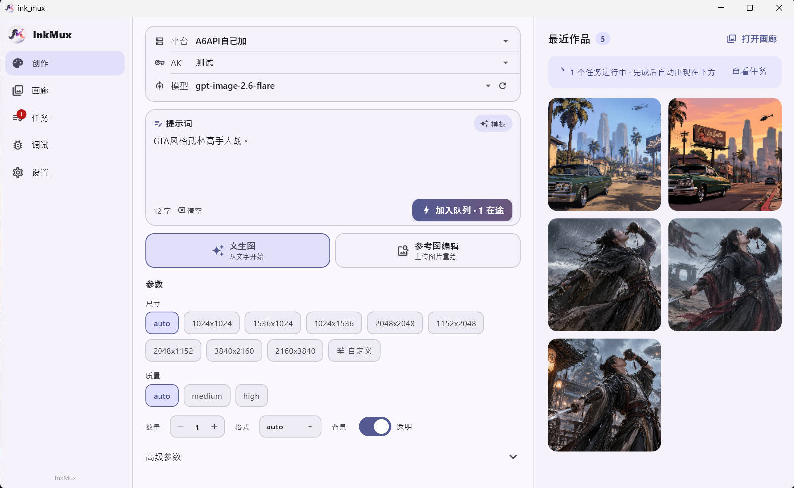

# Ink Mux

一个兼容 OpenAI 图片接口的云端大模型图像生成与编辑的简单客户端。

- 任务、图片、配置全部在本地，API Key 只存系统安全存储
- 支持任意兼容 OpenAI Images 接口的站点，同步与异步任务模式均可接入
- 支持 Windows 桌面与 Android 移动端

桌面端截图：



移动端截图：


基本上只要兼容OpenAI图片接口的云平台或中转站支持下面3个基本端点就能用：

- 使用 `GET /v1/models` 返回 Bearer 令牌可见的 OpenAI 风格模型列表
- 使用 `POST /v1/images/generations` 文生图；响应为 OpenAI Images 结构（`data[]`）
- 使用 `POST /v1/images/edits` 参考图编辑（multipart，`image[]` + `prompt`）
- 支持异步的（即支持上面端点后加 `/async` 关键字的）更灵活方便，若支持则优先使用

## 使用指南

从 [Releases](https://github.com/Sanotsu/ink-mux/releases) 直接下载对应平台应用即可。

## 功能特性

### 创作页面

- 文生图与参考图编辑（编辑模式支持拖拽/相册导入多张参考图）
- 平台 / 模型 / AK 三级选择，参数：数量、尺寸、质量、背景
- 平台故障转移（主模型失败自动换备用模型）、幂等 Key 防重复扣费
- 看门狗兜底：上游长时间无终态自动失败释放并发名额
- 桌面三列布局可拖动显示宽度

### 任务引擎

- 本地排队 + 并发上限，取消 / 重试 / 换 AK 重试 / 仅重试保存（结果已就绪但下载失败）
- unknown 任务恢复：提交在途被杀 → 同幂等 Key 安全重试
- 启动恢复：非终态任务（排队/提交/等待/落盘）重启 App 后自动续跑
- 后台完成/失败本地通知；任务详情完整参数快照与时间线

### 画廊与历史

- 月分组网格、收藏、全文搜索、缩略图加速、滚动分页
- 多选批量保存到相册 / 分享；无图任务一键回全库视图
- 创作历史跨会话存档：详情回看、再次生成（带原参数与参考图）

### 设置与数据

- 平台管理：同步 / 异步任务模式、Base URL 修改、自定义站接入
- AK 管理：多 Key、默认 Key、停用（被任务引用不物理删）、连通性测试
- 备份 / 恢复：zip 流式压缩（大图库内存占用恒定），可选保存位置
- 配置导出 / 导入（不含 AK 密文）；调试日志导出可选位置

### 调试日志

- 请求 / 响应日志时间线（入库前脱敏：Key 头掩码、base64 截断）
- 环形缓冲可调上限（1k~2 万条），按会话 / 仅错误过滤

## 接入 OpenAI 兼容站

设置 → 平台管理 → 添加自定义站：

- 填写显示名、Base URL（含 `/v1`，如 `https://example.com/v1`）、任务模式（同步 / 异步）。
- 鉴权统一使用 `Authorization: Bearer <AK>`。

**同步模式**（必选端点）：

| 端点                          | 说明                                          |
| ----------------------------- | --------------------------------------------- |
| `POST /v1/images/generations` | 文生图；响应为 OpenAI Images 结构（`data[]`） |
| `POST /v1/images/edits`       | 参考图编辑（multipart，`image[]` + `prompt`） |

**异步模式**（需要完整支持受理 + 轮询两组端点）：

| 端点                                | 说明                                                |
| ----------------------------------- | --------------------------------------------------- |
| `POST /v1/images/generations/async` | 异步文生图受理，返回 `202`                          |
| `POST /v1/images/edits/async`       | 异步参考图编辑受理（multipart），返回 `202`         |
| `GET {poll_url}`                    | 任务轮询；缺省拼 `{base}/v1/images/tasks/{task_id}` |

异步受理响应体需包含 `task_id`（或 `id`），可选 `poll_url`（缺失时回退读 `Location` 响应头，仅接受 http(s)）与 `expires_at`（秒级 Unix 时间戳，查询期）。

轮询响应体结构：

```json
{
  "status": "processing | completed | failed",
  "result": { "data": [ ... ] },
  "error": { "code": "...", "message": "..." },
  "http_status": 500
}
```

- `processing`：继续轮询（客户端指数退避 + 回前台立即补询）
- `completed`：`result` 为 Images 结构（`data[]`），每项支持 `url` 或 `b64_json`，可带 `revised_prompt` / `width` / `height`
- `failed`：`error`（`code` / `message`）与 `http_status`（snake_case，兼容 camelCase）用于错误映射与可重试判定

`usage` 字段可选（`total_tokens` / `input_tokens` / `output_tokens`），提供后用于用量统计。

## 快速开始

环境要求：Flutter stable（Dart ≥ 3.13）。

```powershell
flutter pub get
flutter run -d windows   # 或 -d <android-device>
```

## 打包与分发

### Windows 绿色版

使用 [Fastforge](https://fastforge.dev) 打包 Windows 绿色版 zip（解压即用，无安装器），配置见 `distribute_options.yaml`。

前置要求：

```powershell
dart pub global activate fastforge
```

并具备 `flutter build windows` 构建环境（Visual Studio 含「使用 C++ 的桌面开发」组件）。

```powershell
fastforge package --platform windows --targets zip --artifact-name 'InkMux-{{version}}-{{platform}}-release.{{ext}}'
```

产物：`dist/<版本>/InkMux-<版本>-windows-release.zip`（含 `ink_mux.exe` + 运行库 DLL + `data/`，约 17 MB）。

已构建过可加 `--skip-clean` 跳过全量重建。

### Android APK

签名配置读取 `android/key.properties`（不入库，需本地自备）；版本号来自 `pubspec.yaml` 的 `version: <name>+<code>`。

```bash
flutter build apk --split-per-abi --obfuscate --split-debug-info=debug_info
```

`android/app/build.gradle.kts` 中的 `copyFlutterApksToDist` 任务会在 `assembleRelease` 结束后自动把产物复制并重命名为：

```
dist/<版本>/InkMux-<版本>-android-arm-release.apk      # armeabi-v7a（老 32 位设备）
dist/<版本>/InkMux-<版本>-android-arm64-release.apk    # arm64-v8a（主流设备）
dist/<版本>/InkMux-<版本>-android-x64-release.apk      # x86_64（模拟器/Chromebook）
```

若只需真机包，可加 `--target-platform android-arm,android-arm64` 跳过 x86_64；不带 `--split-per-abi` 则只产出一个 universal 包（命名后缀 `universal`）。

混淆符号输出在 `debug_info/`（或 `--split-debug-info` 指定目录），**需随版本归档**，崩溃堆栈还原依赖对应版本的符号文件。注意 `--split-per-abi` 会按 ABI 调整 versionCode（`ABI_VERSION * 1000 + build number`），如需固定可加 `--` 后接 `-P force-version-code-ignoring-abi=true`。

## 项目结构

```
lib/
├── app/       bootstrap / router / providers
├── core/      constants / theme / log / util / error
├── domain/    entities（json_serializable）+ values
├── data/      db(schema+daos) / network(dio_hub+sink+interceptor) / repos / secure / storage
└── ui/        shell / screens(studio|gallery|tasks|history|settings|debug) / widgets
tool/smoke/
```

## 技术选型与约定

| 项       | 说明                                                                                   |
| -------- | -------------------------------------------------------------------------------------- |
| 状态管理 | Riverpod 仅基础 API 手写声明（无 codegen），任务引擎长生命周期 keepAlive               |
| 网络     | 唯一 HTTP 栈 dio，全部请求经 `DioHub`（会话/任务标识注入，调试拦截器统一记日志）       |
| 存储     | sqflite 直写 SQL，DAO 薄类，列名 snake_case；schema 单一来源 `lib/data/db/schema.dart` |
| 代码生成 | 仅 json_serializable（build_runner 唯一生成链）                                        |
| 实体     | Dart 3 原生 `sealed` + 手写 `==`/`copyWith`                                            |
| 密钥     | API Key 明文只存在于 `KeyVault` 与系统安全存储之间，日志入库前经 `LogSanitizer` 脱敏   |
| 数据位置 | 桌面端 `文档/InkMux/`（数据库、图片、日志、备份）                                      |

## 开发环境

在一个 Windows 11 中使用 Flutter 3.50.0 进行开发。

```sh
>flutter --version
Flutter 3.50.0 • channel stable • https://github.com/flutter/flutter.git
Framework • revision ab2912035e (8 days ago) • 2026-11-09 08:50:21 -0800
Engine • hash bf601093ad255aaf5c6d0fc5c4f9acfa60943b2a (revision 371f77202a) (9 days ago) • 2026-11-09 15:57:36.000Z
Tools • Dart 3.14.0 • DevTools 2.61.0
```

测试过的设备：

- 努比亚 Z60 Ultra (Android 14)
- 小米 12S (Android 13)
- 小米 6 (Android 15)
- 机械革命 耀世 16 Pro 2024 (Windows 11)

## 贡献指南

欢迎提交 Issues 来帮助改进项目。

以上，如果有什么问题请不吝指导，谢谢。
